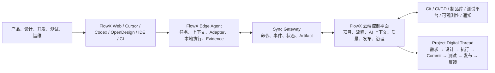
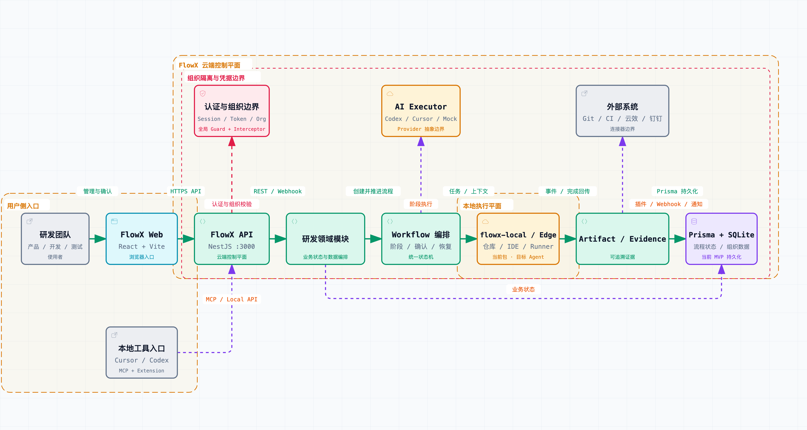
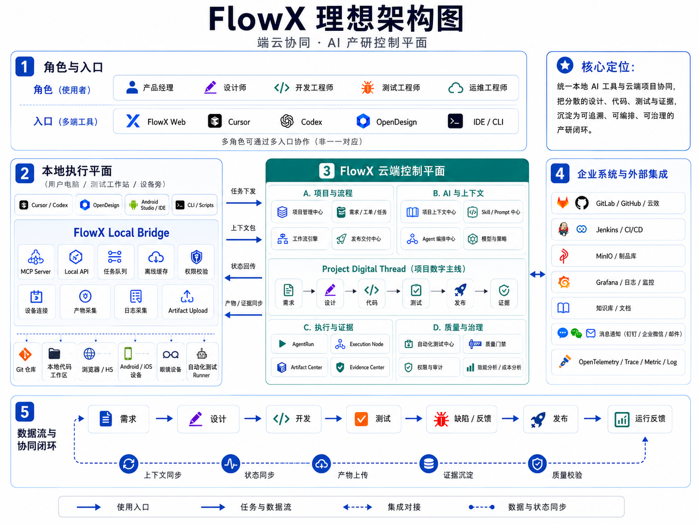

# FlowX

FlowX 是一个正在从 AI 研发流程编排 MVP 演进为端云协同 AI 产研平台的项目。

Cursor、Codex、OpenDesign、IDE、CLI 和自动化测试工具继续作为端侧专业执行环境；FlowX 负责组织级项目、上下文、流程、状态、证据、质量、交付和治理。

## Architecture



完整目标架构、同步协议、数据模型和 90 天实施路线见 [FlowX 端云协同 AI 产研平台目标架构](docs/architecture/edge-cloud-ai-rd-platform.md)。

当前实现的高层架构图（Archify）：





### 当前已具备的基础

1. `Workspace`、`Project`、`Requirement`、排期和项目简报。
2. 一条工作流内的产品构思、设计、Spec & Plan、执行、AI Review 和人工确认。
3. Codex、Cursor、Mock executor 抽象，以及 OpenDesign 本地设计会话。
4. Cursor Extension、`flowx-local`、本地执行交接、运行控制检查点、可靠 Outbox 和本地完成回传。
5. Workflow Repository、工作分支、Artifact 和本地预览。
6. ReviewFinding、Issue、Bug、每日 Code Review 和投递目标。
7. Git 凭据、AI 凭据、认证和组织用户管理。

### 快速创建需求

普通创建只需标题和发布版本，默认选中项目当前版本；描述、验收标准和仓库范围为折叠的选填项。项目详情在「需求列表」右侧点击「新建需求」，只填标题即可归入当前版本；也可选传原型 ZIP，由 AI 自动整理并接入研发流程，无需确认，失败保留标题和文件以便重试。没有当前版本时先在版本管理中设置。描述与验收标准可在后续 AI 构思中完善。本地 MCP 创建同步支持省略这两个字段。

### 删除需求

需求列表和需求详情可以删除需求。删除会移除对应工作流、构思、排期和原型材料；缺陷与问题保留。执行中，或已纳入测试设计、提测的需求不能直接删除。

### 从已有原型直接发起研发

在「需求 → 创建需求 → 已有原型」选择项目、发布版本并上传 ZIP；版本默认带出项目当前版本，也可改选，未选择版本时会提示补齐。一句话目标可留空。平台自动识别 HTML、图片、说明和源码，保留原包及可预览页面，由 Codex / Cursor 自动整理需求、验收标准与设计说明，成功后自动启动工作流，仓库准备完成即进入 Spec & Plan。导入工作流会按平台规范将页面归一为平台端、手机端、眼镜端；ZIP 根目录名不会直接成为端，无法识别的页面默认放入平台端。无需回答导入问题、保存草稿或确认；未明确事项保留在方案中，不作为用户已确认规则。复用已有原型，不重复生成和审批构思、设计。在工作流的「设计方案」可切换查看导入页面，支持 ZIP 内中文目录及多层目录。

页面仅展示处理中、成功或失败；失败保留原材料，点击「重新导入」即可沿用原 ZIP，也可选择新 ZIP 并切换 Codex / Cursor。换包按新 ZIP 完整替换分析材料，历史原包仍可下载；流程接续失败时直接复用已有整理结果。已识别的认证问题会提示检查凭证或切换 AI。HTML 交互在双层隔离预览中运行，联网资源、后端 API 和部分动态加载不可用；源码项目不会安装依赖或启动开发服务器。图片首版仅识别文件信息，PDF/Word 仅保留附件，不能当作已完成视觉或全文理解。ZIP 上限 20 MiB，单文件 5 MiB、解压后总量 60 MiB、最多 1500 文件。详见 [原型导入说明](docs/prototype-import.md)。

升级新增 `PrototypeImport` 表，先备份 SQLite，再执行现有 `prisma:generate` 与 schema 同步步骤。原材料保存在 API 工作目录的 `.flowx-data/prototype-imports`，需随运行数据持久化和备份。

### 需求发生变更

在需求详情或工作流详情点击「需求变更」，一句话说明调整内容即可。「提交变更」继续当前流程，后续 AI 生成和本地任务领取自动携带正式变更；也可附上新的原型 ZIP，此时只能「重新走流程」，平台会默认沿用当前 AI，也可切换 Codex / Cursor。新 ZIP 独立整理并绑定新流程，旧流程与产物保留。变更无需另行审批，自动记录提交人和时间。

正在运行的任务不会被视为已接收新变更，页面明确提示尚未同步；需要结束原任务并重新领取。重新走流程遇到实际活跃任务时，变更先保存，结束任务后点击「继续启动流程」；仅待执行或待确认的旧轮可被新轮替代，历史仍可查看。

升级前备份 SQLite，并执行现有 schema 同步步骤以新增 `RequirementChange` 表、需求修订及流程关联字段；重新生成 Prisma client 后重启 API。

### 多人多仓代码交付

同一需求共用一份已确认的 PRD、设计和 Spec & Plan。成员自行使用 IDE 开发，在工作流“代码交付”中选择仓库并填写已推送分支，无需分配或领取开发任务。平台自动记录提交人、时间和完整 commit；各次提交不会自动结束开发。准备好后每仓选择一条最终交付分支，确认后冻结版本与实际 Git diff，进入既有 AI 审查、人工评审和提测。未覆盖仓库会提示；分支核验不代表合并、测试或联调通过。首版支持分支名，暂不解析 PR/MR URL 或同步 CI 状态。

本轮新增 `CodeBranchSubmission` 表。已有部署升级前备份 SQLite，按现有 schema 同步流程执行 `pnpm prisma:generate` 与 `pnpm --filter flowx-api exec prisma db push --schema ../../prisma/schema.prisma`；Docker 启动仍通过现有 `db push` 同步。详见 [用户手册](docs/user-manual.md) 与 [部署说明](docs/docker-deployment.md)。

### 小团队当前可用的运行控制

需求详情可直接接续已有工作流：一条活跃流程时显示「继续当前工作流」，多条时按仓库范围逐项选择；已完成或失败的流程保留历史入口。需要另起流程时，仍通过启动窗口选择仓库与执行器，并查看已有占用范围。工作流详情将当前任务、执行人、本地回报、下一步和阶段产物放在前面，需求背景、分支、统计与质量入口默认折叠。

本地 Agent 在仓库中执行，FlowX Web 管理执行会话、检查点、阻塞、取消命令、回执和完成证据。失联只表示超过 5 分钟没有收到检查点；取消需要本地 Agent 协作确认，不能远程强杀 IDE。完成回传绑定原执行会话，并按任务基线核对提交。

本地构思、设计和 Spec & Plan 按原领取人回传，同阶段同时领取只有一人成功。领取成功不代表 IDE 已启动；缺少真实本地回报时显示「尚未确认本地运行状态」。需要换人时，原执行人或同组织管理员先在原设备停止任务，再通过「结束本次本地任务」填写原因并确认交接；历史无执行人记录的任务仅管理员可处理。该入口只结束旧的非协作式平台会话，下一人领取新的阶段尝试；开发阶段继续使用停止请求与本地回执。

进入系统默认打开“看板”，顶部展示进行中、需关注、已完成和全部四张数量概览卡，点击可切换下方任务范围。概览按项目、执行人、工具和需求名称搜索的完整范围统计，不受当前页、视图或精确状态筛选影响。下方以响应式卡片集中查看并行的本地开发任务，默认展示进行中任务，异常优先；支持项目、执行人、工具、状态及需求名称筛选。列表每页 20 条，支持页码切换，并保留筛选和页码。进度取自实际回传的摘要、进度事件和测试证据；心跳不代表开发进度，没有内容时明确显示暂无进度回报。独立详情按当前进展、最近进展和开发结果展示；代码提交、变更文件、测试和构建分别呈现，标明本地回报与核验状态。设备和检查点等技术信息默认折叠，开发操作继续在本地进行。

新版 `flowx-local` 的 `flowx_execution_checkpoint` 支持可选 `progressSummary`，让本地 Agent 回报已完成什么、正在做什么。使用新参数需更新客户端并重新加载 IDE 的 FlowX MCP/执行技能；旧客户端继续兼容普通检查点。

### 目标演进方向

1. 将 `flowx-local` 演进为统一 FlowX Edge Agent。
2. 通过 Tool Adapter SPI 接入 Cursor、Codex、OpenDesign、测试 Runner 和设备节点。
3. 建立版本化、幂等、可追踪的端云同步协议。
4. 建立独立测试与质量中心以及统一 Artifact/Evidence Center。
5. 用 Project Digital Thread 串联需求、设计、执行、代码、测试、发布和运行反馈。
6. 在保持模块化单体的前提下，逐步引入 PostgreSQL、队列、对象存储和独立 Worker。

## Stack

- Backend: NestJS + TypeScript + Prisma + SQLite（当前 MVP）
- Frontend: React + shadcn/ui + Tailwind + Vite
- Local integration: Cursor Extension + `flowx-local` + OpenDesign Adapter
- AI integration: Codex / Cursor / Mock executor + OpenDesign
- Target infrastructure: PostgreSQL + Redis/BullMQ + MinIO/S3 + Workers

## Engineering guardrails

- Agent rules: `AGENTS.md`
- AI maintainability guide: `docs/architecture/ai-maintainability.md`
- Validation command: `pnpm check`

## Structure

- `docs/system-design.md`: 当前系统设计与目标演进索引
- `CHANGELOG.md`: 项目变更记录
- `docs/architecture/edge-cloud-ai-rd-platform.md`: 端云协同目标架构、协议和实施路线
- `docs/superpowers/plans/2026-07-22-edge-cloud-foundation.md`: 第一阶段端云协同底座实施计划
- `docs/docker-deployment.md`: Docker 与 Nginx 部署指南
- `apps/api`: backend service
- `apps/web`: basic management UI
- `prisma`: Prisma schema

## Quick start

1. Create `.env` in the repository root:

```env
DATABASE_URL="file:./dev.db"
PORT=3000
VITE_API_BASE_URL="http://localhost:3000"
DINGTALK_APP_ID=""
DINGTALK_APP_SECRET=""
DINGTALK_AGENT_ID=""
YUNXIAO_WEBHOOK_SECRET=""
YUNXIAO_PERSONAL_ACCESS_TOKEN=""
YUNXIAO_ACCESS_KEY_ID=""
YUNXIAO_ACCESS_KEY_SECRET=""
YUNXIAO_REGION_ID="cn-hangzhou"
YUNXIAO_API_ENDPOINT=""
```

1. Install dependencies:

```bash
pnpm install
```

1. Generate Prisma client and sync schema:

```bash
pnpm prisma:generate
pnpm --filter flowx-api exec prisma db push --schema ../../prisma/schema.prisma
```

1. Start both apps:

```bash
pnpm dev
```

### 本地 OpenDesign 设计

OpenDesign 跑在设计师本机。打开正在使用的 FlowX，进入「本地 Agent」复制安装命令，再执行 `flowx-local login`。安装器不要求预先安装 Node.js；没有可用版本时会自动下载 FlowX 私有 runtime。详见 [本地 Agent 使用指南](docs/local-agent-guide.md)。贡献者可用 `pnpm --filter @flowx-ai/local build && pnpm flowx-local serve`。

## Docker deployment

完整部署说明见 [docs/docker-deployment.md](/Users/chalkley/workspace/FlowX/docs/docker-deployment.md)。

This repo includes a multi-stage `Dockerfile` that builds both the API and the web app.

Build the image:

```bash
docker build \
  --build-arg VITE_API_BASE_URL="/api" \
  -t flowx:latest .
```

Run the container:

```bash
docker run -d \
  --name flowx \
  -p 3000:3000 \
  -p 4173:4173 \
  -e PORT=3000 \
  -e WEB_PORT=4173 \
  -e DATABASE_URL="file:/data/dev.db" \
  -e AI_EXECUTOR_PROVIDER="mock" \
  -e OPENAI_API_KEY="your_openai_api_key" \
  -e CODEX_HOME="/data/.codex" \
  -e DINGTALK_APP_ID="your_app_id" \
  -e DINGTALK_APP_SECRET="your_app_secret" \
  -e DINGTALK_AGENT_ID="your_agent_id" \
  -e YUNXIAO_WEBHOOK_SECRET="your_webhook_secret" \
  -e YUNXIAO_PERSONAL_ACCESS_TOKEN="your_yunxiao_personal_access_token" \
  -e YUNXIAO_ACCESS_KEY_ID="your_yunxiao_access_key_id" \
  -e YUNXIAO_ACCESS_KEY_SECRET="your_yunxiao_access_key_secret" \
  -e GIT_AUTHOR_NAME="FlowX Bot" \
  -e GIT_AUTHOR_EMAIL="flowx@example.com" \
  -v flowx-data:/data \
  flowx:latest
```

Notes:

- API runs on `3000`
- Web runs on `4173`
- SQLite data is stored in `/data/dev.db`, so mounting `/data` is recommended
- The container startup script will run `prisma db push` automatically before starting services
- Before `db push`, it also applies idempotent SQLite pre-migrations (including assigning existing workspaces to an organization, adding Yunxiao integration indexes safely, and dropping obsolete `Task`/`Plan` and deploy integration tables)
- The runtime image now installs both Codex CLI and Cursor CLI
- Codex login state is stored under `/data/.codex` by default, so mounting `/data` will persist `codex login`
- `AI_EXECUTOR_DEFAULT_PROVIDER` can be set to `codex` or `cursor` as the default provider for new workflows
- If you want to use `AI_EXECUTOR_PROVIDER="codex"`, set `OPENAI_API_KEY` in the container
- If you want to use Cursor on the server, set `CURSOR_API_KEY` in the container and choose `Cursor CLI` when starting a workflow
- If you want each user to use their own Cursor API Key, set `FLOWX_CREDENTIAL_MASTER_KEY` and let users configure credentials in `AI 凭据` page
- If you want to enforce user-only Cursor credentials (no instance fallback), set `FLOWX_CURSOR_REQUIRE_USER_CREDENTIAL=true`
- If you want each user to use their own Codex/OpenAI API Key, set `FLOWX_CREDENTIAL_MASTER_KEY` and let users configure credentials in `AI 凭据` page
- If you want to enforce user-only Codex credentials (no instance fallback), set `FLOWX_CODEX_REQUIRE_USER_CREDENTIAL=true`
- If you want workflow `提交并推送到远程` to work, the container must have:
  - reachable git remote credentials (SSH key or HTTPS token)
  - git identity configured, e.g. `GIT_AUTHOR_NAME` and `GIT_AUTHOR_EMAIL`
- `AI_EXECUTOR_PROVIDER="codex"` still requires valid Codex authentication in the container; in server environments the simplest way is `OPENAI_API_KEY`
- If Docker/host kernel blocks Codex `read-only` sandbox with `bwrap: No permissions to create a new namespace`, set `CODEX_READ_SANDBOX="danger-full-access"`
- OpenDesign 推荐通过设计师本机的 `flowx-local` Adapter 接入；API 主机上的 `OPENDESIGN_MCP_ENABLED` 仅保留为旧服务端 AI 设计链路的兼容能力。见 [docs/opendesign-design-stage.md](/Users/chalkley/workspace/FlowX/docs/opendesign-design-stage.md)

### Using manual `codex login` in Docker

If you are still in a personal-use stage and prefer logging into Codex manually instead of configuring `OPENAI_API_KEY`, you can:

1. Start the container with `AI_EXECUTOR_PROVIDER="codex"` and mount `/data`
2. Enter the container once and run `codex login`
3. Keep using the same `/data` volume so `/data/.codex` persists across restarts

Example:

```bash
docker run -d \
  --name flowx \
  -p 3000:3000 \
  -p 4173:4173 \
  -e PORT=3000 \
  -e WEB_PORT=4173 \
  -e DATABASE_URL="file:/data/dev.db" \
  -e AI_EXECUTOR_PROVIDER="codex" \
  -e CODEX_HOME="/data/.codex" \
  -v flowx-data:/data \
  flowx:latest

docker exec -it flowx sh
codex login
```

After login succeeds once, the Codex auth state will stay in the mounted volume.

### Deploy behind Nginx

If you do not want to expose `3000` and `4173` directly, you can put Nginx in front and expose only port `80`.

1. Build the image with same-origin API requests:

```bash
docker build \
  --build-arg VITE_API_BASE_URL="/api" \
  -t flowx:latest .
```

1. Start with the provided compose file:

```bash
docker compose -f docker-compose.nginx.yml up -d
```

This setup will:

- expose only `80`
- proxy `/api/*` to the API container
- proxy all other paths to the web app

If you are using manual `codex login`, run it once after the containers start:

```bash
docker exec -it flowx sh
codex login
```

## Auth

- Built-in user system with extensible third-party provider abstraction.
- Supports account/password login and registration.
- DingTalk login is available at `/api/auth/dingtalk/*` when deployed behind Nginx.
- For real DingTalk OAuth, set `DINGTALK_APP_ID`, `DINGTALK_APP_SECRET`, and optionally override endpoints via:
  - `DINGTALK_AUTHORIZE_URL`
  - `DINGTALK_TOKEN_URL`
  - `DINGTALK_PROFILE_URL`
  - `DINGTALK_ORGS_URL`
- For personal stage completion notifications, also set `DINGTALK_AGENT_ID`.
- FlowX will try to notify only the current DingTalk login user who triggered the stage or confirmation, instead of broadcasting through a group robot.
- 钉钉组织管理员可在“用户管理”中同步通讯录用户。同步会新增或更新用户，并将已不在钉钉通讯录中的钉钉成员移出当前组织；用户账号和历史数据不会删除，但该组织下的会话和 Personal API Token 会失效。FlowX 不保存部门结构；钉钉应用需具备通讯录部门和用户读取权限，包括 `qyapi_get_department_member`。
- 每个组织保留一名主管理员；主管理员可以给多个成员分配或收回“子管理员”角色。子管理员可以执行组织内普通管理操作，但不能编辑、移除主管理员，也不能转让主管理员权限；只有主管理员可以分配子管理员和转让权限。
- 支持通过固定地址 `/api/yunxiao-webhooks` 接收云效自动化规则的原生工作项数据，并通过云效项目成员的 `memberId`、`userId` 和阿里云账号绑定 ID 与管理员手动关联的 FlowX 用户，向负责人、参与者、验证者和创建者发送去重后的钉钉个人通知。云效 Secret 通过 `X-Projex-Signature` 校验，服务端配置 `YUNXIAO_WEBHOOK_SECRET` 和 `YUNXIAO_PERSONAL_ACCESS_TOKEN`（也兼容 AccessKey），组织管理员可在“云效集成”页面绑定 `organizationIdentifier`、加载项目成员并一键启用或停用；未匹配人员会在页面保留记录。详见[云效 Webhook 钉钉通知接入](docs/yunxiao-webhook.md)。
- 组织管理员可以在“云效集成”页面清空当前组织的未匹配人员记录；该操作不会影响成员映射、已匹配投递记录或 Webhook 原始数据。
- 若升级前已有云效成员绑定，可执行 `pnpm db:backfill-yunxiao-mappings --dry-run` 预览并使用 `--yes` 回填三种云效身份 ID；脚本只更新已有绑定，不创建或删除绑定。

## MVP flow

1. Create requirement
2. Start workflow
3. Run repository grounding
4. Optionally run brainstorm and design (or skip)
5. Run Spec & Plan generation
6. Human confirm or reject Spec & Plan
7. Run execution
8. Run AI review
9. Human review and inspect full stage history

本地 Agent 还可以领取 `SPEC_PLAN_PENDING` 工作流，通过 `flowx_get_spec_plan_handoff` 获取上下文，使用 `flowx_upload_artifact` 上传 `spec.md`、`plan.md`、日志、截图、JUnit 或 coverage，再用 `flowx_submit_spec_plan` 回传结构化结果。资料上传失败时会进入本机 Outbox，`flowx-local sync` 使用稳定副本重传。

提测草稿支持创建 `LOCAL_SMOKE` 轮次并按 Web、API、iOS、Android 等目标端展开用例矩阵。多个开发者可分别使用 `flowx_list_smoke_tasks`、`flowx_claim_smoke_task` 和 `flowx_submit_smoke_report` 认领及回传；服务端保留每次执行明细，按 `FAILED > BLOCKED > SKIPPED > PASSED` 聚合。所有必测阻断项通过且没有有效执行租约后，服务端生成版本化 HTML 提测报告并将草稿推进到 `READY`。

冒烟结果必须由原领取人回传。提测详情分别加载基本信息、报告和轮次；尚无报告时正常提示，局部加载失败可单独重试，权限不足、记录不存在和网络错误分别展示。
