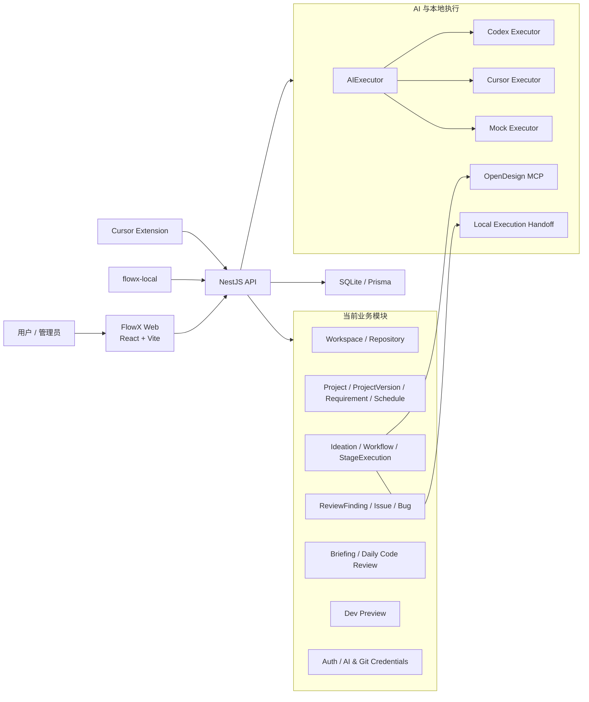

# FlowX 系统设计：现状与目标演进

> 本文描述当前代码已经具备的系统边界，并链接到后续建设采用的目标架构。规划能力不能当作已上线能力对外承诺。

## 1. 系统定位

FlowX 当前是一个支持中断、恢复和人工确认的 AI 研发流程编排系统，已经覆盖工作区、项目、需求、AI ideation、研发工作流、本地执行交接、审查沉淀、排期、项目简报和每日 Code Review。

后续目标是演进为端云协同 AI 产研平台：用户继续使用 Cursor、Codex、OpenDesign、IDE、CLI 和测试工具完成专业工作，FlowX 作为组织级控制平面统一项目、上下文、流程、状态、证据、质量、交付与治理。

完整目标架构见：

- [FlowX 端云协同 AI 产研平台目标架构](architecture/edge-cloud-ai-rd-platform.md)
- [目标架构展示图](architecture/assets/flowx-edge-cloud-ai-rd-platform.png)

## 2. 当前实现架构



## 3. 当前模块边界

### 3.1 后端

| 模块 | 当前职责 | 目标中心 |
| --- | --- | --- |
| `workspaces` | 工作区、Repository 登记、同步和本地副本 | 项目管理中心 / AI 上下文中心 |
| `projects` | 项目基础信息、发布版本清单与当前版本 | 项目管理中心 |
| `requirements` | 需求、ideation 与设计编排 | 项目管理中心 / 研发流程中心 |
| `prototype-imports` | 原型 ZIP 私有存储、AI 整理、草稿版本与一次确认 | 项目管理中心 / 研发流程中心 |
| `workflow` | 工作流状态机、阶段执行、本地/云端执行和审查 | 研发流程中心 |
| `ai`、`prompts` | Executor、Prompt 和输出 schema | AI 上下文中心 |
| `schedule` | 需求排期与成员分配 | 项目管理中心 |
| `briefings` | 项目事件、简报、投递目标 | 项目管理中心 / 治理与度量中心 |
| `daily-code-review` | 独立 Code Review 调度和报告 | 测试与质量中心 |
| `review-artifacts` | Finding、Issue、Bug 转换和维护 | 测试与质量中心 |
| `quality` | 需求驱动测试设计、Workspace/项目用例比对与优化、动态冒烟、提测门禁、用例快照、Test Run 与 Bug 回归闭环 | 测试与质量中心 |
| `dev-preview` | 本地预览命令和生命周期 | 发布与运维中心 |
| `auth` | 用户、组织、会话、凭据，以及钉钉通讯录用户增量同步（不持久化部门结构） | 治理与度量中心 |
| `plugins` | 内置外部集成注册、组织级启停和第三方系统适配 | 治理与度量中心 / 企业集成中心 |
| `yunxiao-webhooks` | 云效自动化事件接收、组织成员匹配、幂等记录和钉钉个人通知 | 治理与度量中心 |
| `cursor-local` | Cursor 本地任务和 Chat 交接 | 迁移到通用 Edge/Sync 边界 |

### 需求最小创建契约（2026-10-23）

`POST /requirements` 由 `projectId` 指定归属，业务必填为非空白 `title` 和有效发布版本。`description`、`acceptanceCriteria` 选填，省略或为空时保存为空字符串；字符串统一去除首尾空白。显式 `versionId` 必须属于该项目；省略时兼容使用项目当前版本，显式 `null` 或没有当前版本返回 400，不创建无版本普通需求。历史记录、更新接口的版本清空语义和原型导入草稿契约保持兼容。

Web 普通表单默认当前版本、折叠选填字段；项目详情快捷弹窗只输入标题，并显式提交弹窗显示的当前版本 ID，成功刷新并筛选到该版本。没有当前版本时引导版本管理。两入口均防重复提交，失败保留输入。本地 MCP 同步允许省略描述和验收标准，拒绝显式空版本；Skill 不再生成占位验收内容。

### 3.2 前端

FlowX Web 当前提供：

- 工作区和 Repository 管理。
- 项目、发布版本、需求、工作流和排期。
- Ideation、设计 Artifact、执行、Review 和人工确认。
- Issue、Bug、项目简报和每日 Code Review。
- AI/Git 凭据、组织用户、数据源和投递目标设置。
- Workspace 是业务数据的组织隔离根；Project、Requirement、WorkflowRun、Issue、Bug、简报、Code Review 与产物均沿 Workspace 继承组织边界，跨组织按 ID 访问也必须返回不可见。

后续页面应围绕六个中心组织，但在功能具备前不进行只改导航名称的空壳重构。

### 3.3 本地接入

当前本地接入由两部分组成：

- `apps/cursor-extension`：任务列表、仓库匹配、Chat 交接和完成报告。
- `packages/flowx-local`：本地启动、Repository 映射、IDE 打开和 Skill 安装。

演进方向是保留现有兼容接口，将 `flowx-local` 扩展为 FlowX Edge Agent，并把 Cursor 专用逻辑下沉为 `CursorAdapter`。

## 4. 当前核心数据链路

```text
Workspace
  -> Project
     -> ProjectVersion (currentVersionId)
     -> Requirement (versionId?)
  -> RequirementRepository
  -> WorkflowRun
  -> WorkflowRepository
  -> StageExecution
  -> CodeExecution / ReviewReport
  -> ReviewFinding
  -> Issue / Bug
```

该链路已经具备研发流程基础；Artifact、Evidence、ExecutionSession 以及 TestDesign/TestRequest/TestPlan/TestRun 的独立模型已经落地。开发执行的受控会话由 `ExecutionCommand`、检查点和回执构成协作式运行控制：云端保存状态和命令，本地 Agent 在检查点领取并确认。失联是基于服务端最后检查点的健康计算，不代表可以远程终止 IDE。完成报告必须绑定原会话和原执行人，按工作流基线核对 Git 提交后才推进 Review。Spec & Plan 可由本地 `ExecutionSession` 领取，结构化输出继续写入 `StageExecution`，`spec.md` 和 `plan.md` 作为 Artifact 上传。TestDesign 在 Spec & Plan 确认后与开发执行并行，提测前汇合并冻结功能与动态冒烟快照。`LOCAL_SMOKE` 通过 `TestRunTarget`、`TestExecution` 和 append-only `TestExecutionCaseResult` 支持多人多端执行，服务端聚合 `TestResult` 并生成版本化 `TEST_REPORT`。Release、RuntimeFeedback 和自动化测试结果导入仍需继续建设。

### 工作流接续与本地协同

需求详情从已有 `WorkflowRun` 展示状态与仓库范围：单条活跃流程直接继续，多条逐项选择，终态保留历史入口。另起流程复用启动窗口的仓库与执行器选择，展示占用范围并由服务端校验冲突。工作流详情将当前任务、阶段导航、产物与操作前置，需求背景、分支、统计与质量入口默认折叠；当前任务始终取服务器当前阶段，不随历史阶段选择改变。

`GET /workflow-runs/:id/collaboration` 在组织权限内纯读取各阶段最新 attempt 的最新本地 `ExecutionSession`，返回执行人、运行健康度、最近回报与操作权限，不调用会隐式领取的 handoff。健康度复用 `getExecutionHealth`；`controlMode=NONE` 或缺少真实检查点的会话属于未知状态，领取时间不得作为本地启动证据。失联只表示缺少新回报，不能自动释放会话。

本地构思、设计和 Spec & Plan 的领取与回传统一核对组织及 `claimedByUserId`：原领取人幂等领取复用原会话，他人领取得到冲突，并发首次领取只允许一个成功。回传不能以组织访问权限替代领取身份；无领取人的历史会话必须先重新交接。`flowx_get_workflow_position` 在他人占用时返回兼容动作 `localAction: none` 和等待说明，继续上下文只采用最新已确认的上游产物，不能因本机文件或旧聊天推断阶段。

`POST /workflow-runs/:id/local-task/release` 接收 `{ executionSessionId, confirmedStopped: true, reason }`，`reason` 去空白后必填且不超过 2000 字。该恢复入口仅允许当前 `BRAINSTORM`、`DESIGN`、`SPEC_PLAN` 待执行阶段最新 attempt 中仍活动的、`controlMode != COOPERATIVE` 的本地任务。原执行人或同组织管理员可操作，无 owner 的历史会话仅同组织管理员可操作；必须确认已在原设备停止。事务将旧会话置为 `CANCELLED`、当前 `StageExecution` 置为 `FAILED`，并以 `execution.local_task_released` 记录操作人、原因和停止确认。后续领取创建新 attempt，旧会话的晚到回传被拒绝。此接口不能远程关闭 IDE，开发阶段的协作式停止请求与本地回执保持原有机制。

所有 `LOCAL` 会话的公共写入口统一使用领取人校验，包括通用心跳/状态、SyncEvent、Artifact 上传/内容/删除与 Evidence；读取仍按组织可见。构思、设计、方案与冒烟的终态只能通过专用编排回传或明确交接，不能用通用 `complete/fail/cancel` 单独改变会话。`CANCELLED` 会话拒绝后续写入。专用设计回传产生的 HTML 绑定 `executionSessionId`；无会话的旧兼容稿按 `createdByUserId` 校验，未记录执行人的历史稿只读。

`POST /workflow-runs/:id/design/submit-local` 仅供尚未使用本地设计会话的旧集成使用，必须提供登录身份并记录产物和阶段执行人、锁定工作流版本。流程一旦存在本地设计会话，该兼容入口返回 `409` 并引导当前会话的专用回传，避免已取消任务绕过晚到结果校验。

### 原型 ZIP 导入与确认快照

`PrototypeImport` 与 Requirement 一对一关联，保存 `ANALYZING / WAITING_CONFIRMATION / FAILED / CONFIRMED` 状态、CAS `revision`、独立材料版本 `materialRevision`、文件清单、AI 分析、答案及确认人/时间。所有读取、下载、预览和写入经需求项目的 Workspace 校验组织。上传先私有保存原包，再事务创建临时需求；异步分析采用现有 AI invocation 的组织凭据上下文。当前任务为单进程后台执行，重启将分析中记录标为可重试失败，保留材料。

Codex / Cursor 的 `analyzePrototype` 共用 `prototype-analysis.output.schema.json`，运行时按同一 schema 校验需求、简报、设计、澄清、来源与推断。分析上下文整体有界，材料被标记为非指令，来源路径必须属于材料清单；不支持的 executor 明确失败。图片未做视觉理解、PDF/Word 未提取正文。保存/补传/重试/确认均比较 revision；Web 编辑基线不随刷新偷换，服务端拒绝旧版本。确认前校验必答项，事务更新 Requirement 和 ideation Artifact 并锁定确认稿。

工作流创建读取已确认导入，未确认阻断，`REQUIREMENT_INTAKE` 保存不可变确认快照。grounding 后使用快照简报和原型页面，记录 BRAINSTORM 为复用跳过、DESIGN 为已确认完成，再经现有状态机到 `SPEC_PLAN_PENDING`。设计稿保持原页面 ID，但持久化文件名采用短摘要，兼容中文长路径；后续重试不重做导入确认。

原型存储在 API 工作目录 `.flowx-data/prototype-imports/{id}/{materialRevision}`，保存各次原包与合并材料。预览静态内联包内资源，不安装依赖或执行构建命令。HTML 置于可信外壳的 sandbox iframe（无 same-origin）中；外壳 CSP 的 `frame-src 'none'` 阻止内部原型自身外部导航，原型 CSP 限制请求、资源与表单。包内导航经消息源校验及清单校验转发；新窗口同样保留可信外壳。它是原型预览环境，不是完整应用运行环境。完整接口、限制与备份见 [原型导入](prototype-import.md)。

### 多仓分支交付

`CodeBranchSubmission` 关联 WorkflowRun、StageExecution、WorkflowRepository 与 User。同阶段、同仓库、同分支、同提交人的记录唯一，重复提交更新本人 headSha。它表示代码来源，不表示任务指派或执行会话。组织隔离同步纳入 Prisma scope。

`GET /workflow-runs/:id/code-delivery` 返回仓库、当前尝试分支、提交权限/原因、已冻结交付及按 attempt 分组的只读 history；历史提交不能确认至当前尝试。`POST .../branches` 接收 `{ workflowRepositoryId, branch }`，服务器读取完整 SHA。首次提交建立 `executor: CODE_DELIVERY` 的开发尝试，进入 EXECUTION_RUNNING，后续多人提交继续汇集。`POST .../confirm` 接收 `{ submissions: [{ id, headSha }], confirmed: true }`；每仓仅一个最终分支，允许显式选择仓库子集。身份来自认证上下文，不接受前端提供提交人。

提交与确认在 Git I/O 前读取流程版本，事务内 CAS 并重新核对当前 attempt，防止分支更新、返工和确认竞争。Git 凭据显式按已校验组织读取，不借用其他组织最近保存的凭据；部署级环境 token 仍沿用既有优先级。Git 在隔离临时 bare 仓库读取共同基线与所选 commit 的实际 diff，不切换主工作副本；分支变化、无差异、权限错误或输出超限会明确失败。确认写入 CodeExecution 与阶段输出的 delivery 快照、工作流级 GIT_COMMIT Artifact，并使用既有状态机到 REVIEW_PENDING。所选仓库工作分支更新为交付分支，清空旧本地路径；AI review 只采用选中仓库上下文和实际 diff。

冒烟版本优先取最新已完成开发 attempt 的 delivery；新尝试尚未完成时不会回退上一轮冻结交付。旧单人完成继续兼容会话 Evidence。已冻结分支交付禁止旧执行结果手改和自动提交推送路径；实际合并、构建、测试和发布结论不由分支存在推断。

从已确认分支切换到云端返工时，CAS 成功后才在后台按交付分支准备所选仓库的新 attempt 隔离 checkout，使用明确组织凭据。阶段 input 的 `sourceDeliveryStageExecutionId` 继承交付范围；后续连续修复保留本地未推送改动，审查与推送同步限定仓库范围。准备失败不调用 AI，旧冻结产物保留供追溯。

### 提测与冒烟读取契约

`LOCAL_SMOKE` 保留按目标端和用例租约并行、版本指纹校验、原始结果追加及失败优先聚合，回传入口同时验证组织和原领取人身份，不能代用他人的 `TestExecution`。有效租约、必测项缺结果或阻断项未通过时仍阻止生成报告。

提测报告读取在尚无报告时明确返回 HTTP 200、JSON `null`，避免空响应导致 JSON 解析失败。提测详情的基本信息、报告和冒烟轮次独立加载，局部失败保留已有信息并单独重试；主请求区分 `403`、`404` 与网络错误，不从空数据推断记录不存在。

### 并行开发进展查询

Web 的默认首页“研发看板”（`/dashboard`）使用 `GET /execution-sessions` 的页码模式，聚合当前组织下 `executorType=LOCAL`、阶段为 `EXECUTION` 的会话。传入 `page` 或 `view` 启用该模式；`view` 支持 `active`、`attention`、`completed`、`all`，Web 默认 `active`。保留 `projectId`、`workflowRunId`、`status`、`sourceTool`、`since`、`until`，新增 `claimedByUserId` 和 `search`（需求名称包含匹配）。`take` 默认 20、最大 100；`page` 为 1～1000000 的整数，不能与 `cursor` 混用。

返回 `{ items, total, page, pageSize, totalPages, counts, nextCursor: null }`，其中 `counts` 包含 `active`、`attention`、`completed`、`all`。概览与列表在同一事务读取，按组织及公共筛选条件统计，忽略 `page`、`view` 和精确 `status`；`active` 与 `attention` 可重叠，不能相加。空结果按第 1/1 页返回，越界页回到末页。服务端先按组织和筛选范围计数，再把阻塞、失败、待停止回执和失联会话置顶，同组按 `createdAt desc, id desc` 排序后分页，计数和记录读取在同一事务完成。失联复用协议中的 `EXECUTION_STALE_AFTER_MS` 和受控会话定义；尚无检查点或旧兼容会话属于未知状态。未传 `page`、`view` 的请求保持旧游标契约和排序。

根路由和普通登录默认进入 `/dashboard`；旧 `/execution-sessions` 列表路径保留查询条件与片段重定向到看板，原详情路由保留。认证保护保存原路径、查询与片段，深链接登录后返回原目标。侧栏看板为首项，列表和详情均归属看板导航。

列表批量附带项目名、阶段状态摘要、最新 `execution.progressed` 事件及测试/构建/Agent 摘要各自最新的一条证据，无需每条会话再发查询。`GET /execution-sessions/:id` 另行返回 `latestProgress`，避免进度被最近心跳挤掉。页面展示已有事实，不采集 IDE 对话、不生成进度百分比。URL 保存筛选和页码，筛选变化回到首页，后台刷新保留已有内容。独立详情使用专用 `DevelopmentProgressDetail` 展示当前进展、最近进展和分类开发结果，不再复用运行控制面板。`GET /execution-sessions/:id/events` 支持可选 `view=progress`，在组织访问校验后先筛选 `execution.*` 且非 `execution.heartbeat` 的事件，再进行原有游标分页；省略 `view` 保持原契约，非法视图返回 400。Web 请求该视图最近 10 条并与 `latestProgress` 合并、去重和倒序展示，心跳不会挤掉历史进展；结果按 `evidenceType` 分类，`REPORTED`、`VERIFIED`、`REJECTED` 显示为本地回报、已核验、核验未通过，不将记录核验状态当作测试结论。技术信息默认折叠，结果读取失败保留已有数据并提示重试。工作流原有协作式控制入口继续保留。

`POST /execution-sessions/:id/checkpoint` 和 MCP `flowx_execution_checkpoint` 支持可选 `progressSummary`（1～2000 字符，去空白后非空）。摘要变化时，在原有执行人、设备和会话版本校验后，同一事务更新会话摘要并追加 `execution.progressed`，重试相同摘要不重复写事件。终态和已有停止请求的会话忽略新摘要，不覆盖已有结果；省略摘要时沿用普通检查点节流。客户端继续保持薄透传，不新增本地状态机和 Outbox 队列。

## 5. 工作流设计原则

- `WorkflowRun` 表达一次业务流程。
- `StageExecution` 按 attempt 追加，保留阶段执行历史。
- 状态流转统一通过 `WorkflowStateMachine` 或工作流编排服务校验。
- 本地执行和云端执行是同一状态机上的不同 executor。
- AI 审查的 `aiProvider` 由本次 `/workflow-runs/:id/review/run` 或 `/review/revise` 请求选择，记录在审查 `StageExecution.input`；未传时使用 `WorkflowRun.aiProvider`，因此开发与审查可以使用不同工具。
- 人工确认是流程能力，不应耦合具体 AI Provider。
- `ExecutionSession` 表达一次本地、Agent、Worker 或测试执行；领取记录和真实本地运行证据分别展示。

## 6. AI 与工具接入原则

- 业务服务依赖 `AIExecutor` 或后续通用执行契约，不直接依赖 Provider SDK。
- Prompt、输出 schema 和校验逻辑保持单一事实来源。
- Cursor、Codex、OpenDesign 等端侧工具通过 Adapter 接入统一同步协议。
- MCP 用于提供上下文和工具调用，不拥有 FlowX 的业务状态。
- 源代码以 Git 为事实来源；FlowX 保存分支、Commit、MR、摘要和 Evidence。

## 7. 目标模块

```text
FlowX 云端控制平面
├── 项目管理中心
├── 研发流程中心
├── AI 上下文中心
├── 测试与质量中心
├── 发布与运维中心
└── 治理与度量中心

FlowX 端侧执行平面
├── FlowX Edge Agent
├── Tool Adapter SPI
├── Repository / Branch Mapping
├── Local Runner
├── Artifact / Evidence Collector
└── Offline Queue

端云同步层
├── Command
├── Context Package
├── Sync Event
├── Artifact Upload
└── Identity / Idempotency / Trace
```

详细领域职责、同步事件、数据所有权和 90 天路线以目标架构文档为准。

## 8. 基础设施演进

| 阶段 | 数据库 | 异步任务 | Artifact | 部署形态 |
| --- | --- | --- | --- | --- |
| 当前 MVP | SQLite | 进程内调度 | 本地文件和数据库记录 | 单实例 API + Web |
| 端云协同第一阶段 | SQLite/PostgreSQL 过渡 | Redis/BullMQ | MinIO/S3 | API + Worker |
| 企业部署 | PostgreSQL | 可靠队列和独立 Worker | Object Storage | 多实例 API + Worker Pool |

近期保持模块化单体，不按业务中心直接拆微服务。拆分触发条件包括独立扩缩容、独立故障域、独立安全边界或明确的团队所有权。

## 9. 实施优先级

1. 抽取通用 Edge Agent、ExecutionSession 和同步协议。
2. 建立 Artifact/Evidence Center 和数字主线关联。
3. 接入 Cursor、Codex、OpenDesign Adapter。
4. 在现有 TestRequest、Test Plan、Test Case、Test Run 基础上接入 AI 影响分析、自动化结果和质量门禁。
5. 串联 Release、Environment 和运行反馈。
6. 再推进 PostgreSQL、多实例、企业权限、审计和成本治理。

## 10. 文档维护规则

- 本文维护当前实现边界和目标演进索引。
- `docs/architecture/edge-cloud-ai-rd-platform.md` 维护目标架构和实施原则。
- 具体功能设计继续放在对应专题文档中。
- 架构发生变化时，先更新 Mermaid 权威图，再更新 PNG 展示图。
- 规划能力上线后，必须同步更新 README、用户手册和相关 API/数据模型文档。
